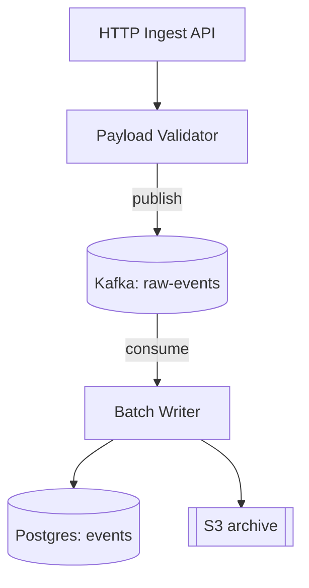

# UML Diagramming

Model the **semantics** of a system, not its syntax. A diagram is worth producing only if another engineer can answer a question from it that they could not answer cheaply by reading the code.

Priority order when these conflict: correctness → traceability → appropriate abstraction → semantic precision → readability → consistency → minimality.

## When not to use this skill

- The user wants a non-software diagram (org chart, mind map, network topology for its own sake, generic flowchart of a business process with no system boundary). Use a plain flowchart instead.
- The user wants an infographic or slide graphic. UML notation will hurt.
- The answer is one sentence of prose. A diagram with three boxes usually is not worth its own artifact.
- The user asked for code, not a model. Diagramming as a preamble to implementation is only useful if the structure is genuinely in question.

## Procedure

1. **State the engineering question** the diagram must answer. If you cannot name it in one sentence, you do not yet know what to draw.
2. **Detect material ambiguity** (§Ambiguity). Resolve low-impact ambiguity silently with the conventional reading; stop and ask when interpretations diverge materially.
3. **Fix the abstraction level** (§Abstraction). One level per diagram.
4. **Select the diagram type** (§Selection).
5. **Establish evidence level** for every element: Observed / Inferred / Assumed / Proposed (§Evidence).
6. **Extract elements and relationships.** For reverse engineering, follow `references/source-analysis.md` — including its reading budget, which bounds how much source to consult before modeling.
7. **Choose the renderer** and check the target diagram type is actually supported (§Renderers).
8. **Emit the diagram**, then **validate** (§Validation).
9. **Split** if the diagram exceeded its readability budget (~15 nodes structural, ~8 lifelines sequential). Offer the decomposition set from `references/domain-patterns.md` rather than shipping one unreadable diagram.

Default output is **one** diagram answering the stated question. Propose additional diagrams; do not produce a seven-diagram set unasked.

## Ambiguity

Resolve using this evidence order; do not let generic architectural convention override the actual system:

```
explicit user requirement → actual source/config → existing docs → strong inference → stated assumption
```

**Material vs immaterial** is the deciding test. Ambiguity is material when different readings produce diagrams an engineer would act on differently.

| Request | Ambiguity | Material? | Action |
|---|---|---|---|
| "Show the UML of the service" | class vs component | No — component is conventional for "the service" | State the interpretation in one line, proceed |
| "Show the architecture" | context / component / class / deployment | Yes | Ask, or give two labeled alternatives |
| "Show how `Order` contains `LineItem`" | association / aggregation / composition | Yes — ownership and lifecycle differ | Ask, or model the weaker relationship and say why |
| "Diagram the auth flow" | current vs proposed | Yes | Ask; never silently document a refactor as existing |

When asking is more expensive than answering, produce clearly labeled alternatives instead of blocking.

**Never invent** classes, services, dependencies, FK relationships, state transitions, API calls, ownership semantics, deployment topology, or runtime behavior. If it cannot be established, label it `[Assumed]` or omit it. A gap in the model is honest; a fabricated box is not.

## Evidence

| Label | Meaning | Requirement |
|---|---|---|
| `[Observed]` | Directly supported by source or configuration | Cite `path:line` or config key when reverse-engineering |
| `[Inferred]` | Logically derived, not explicit | State the inference chain |
| `[Assumed]` | Needed to complete the model | Must appear in the Assumptions block |
| `[Proposed]` | Recommended future design | Must never appear in a diagram labeled *Current architecture* |

Unlabeled elements default to `[Observed]`. Label only where ambiguity affects interpretation — do not decorate every box.

Keep current and proposed models as **separate diagrams**, never as one diagram with mixed elements.

## Selection

| Question | Diagram |
|---|---|
| What classes/interfaces exist and how do they relate? | Class |
| What modules/services exist and what depends on what? | Component |
| How does one request execute across participants? | Sequence |
| Who collaborates with whom (topology over timeline)? | Communication |
| What states can an entity occupy, and what triggers transitions? | State machine |
| What is the workflow or control flow? | Activity |
| What can actors accomplish from outside? | Use case |
| How is code organized logically? | Package |
| Where does software execute? | Deployment |
| What does the object graph look like at one instant? | Object |
| When do things happen, in real time? | Timing |
| What is the relational schema? | ER |
| What is the system-level picture for a mixed audience? | C4 Context / Container |
| Internal ports and connectors of one component? | Composite structure |

UML and C4 compose; do not force one to replace the other. C4 Context/Container for the outer two levels, UML component/class for the inner two, is a common and correct pairing.

## Abstraction

Four levels. Mixing them is the most common failure in generated diagrams.

```
L1 System        users, applications, external systems
L2 Architecture  services, databases, queues, brokers, APIs
L3 Component     major internal units, modules, interfaces
L4 Code          classes, interfaces, attributes, operations, relationships
```

Do not place a database table, a microservice, and a private method in one diagram unless the question explicitly spans levels — and if it does, say so in the Purpose line.

## Relationship semantics

Choose by meaning, not by the shape of the code.

| Relationship | PlantUML | Mermaid | Means | Evidence needed to justify |
|---|---|---|---|---|
| Association | `A -- B` | `A -- B` | Structural link | A holds a reference to B beyond one call |
| Directed association | `A --> B` | `A --> B` | Navigable one way | A reaches B; B has no back-reference |
| Dependency | `A ..> B` | `A ..> B` | A uses B transiently | Parameter, local variable, import, return type |
| Generalization | `B --\|> A` | `A <\|-- B` | B is-a A | `extends` / subclassing with substitutability |
| Realization | `B ..\|> I` | `I <\|.. B` | B implements I | `implements`, protocol/trait conformance |
| Aggregation | `A o-- B` | `A o-- B` | Weak whole-part | Whole holds parts; parts outlive the whole |
| Composition | `A *-- B` | `A *-- B` | Ownership + lifecycle | Part is created by and dies with the whole |

**Arrow direction is the single most common error.** In both renderers the triangle points at the parent/interface. `A <|-- B` reads "B inherits A". Verify direction before emitting.

When evidence is insufficient, **choose the weaker relationship**. Association is recoverable; a wrong composition claims a lifecycle guarantee the code does not make.

Never: inheritance for code reuse; composition merely because one object contains another; aggregation merely because the notation exists; an association for every method call; an interface introduced only to satisfy a pattern.

## Renderers

Prefer text formats that version-control and diff. Default to **Mermaid** when the diagram lands in Markdown, a README, or a GitHub/GitLab surface that renders it natively. Default to **PlantUML** when the diagram needs UML types Mermaid lacks, or when notation fidelity matters more than inline rendering.

| Diagram type | PlantUML | Mermaid |
|---|---|---|
| Class | yes | yes (`classDiagram`) |
| Sequence | yes | yes (`sequenceDiagram`) |
| State machine | yes | yes (`stateDiagram-v2`) |
| ER | yes | yes (`erDiagram`) |
| Component | yes | no — approximate with `flowchart` or C4, and say so |
| Deployment | yes | no — approximate with `flowchart` subgraphs or `C4Deployment` |
| Activity | yes | no — approximate with `flowchart` |
| Use case | yes | no |
| Object | yes | no |
| Package | yes | partial (`classDiagram` namespaces) |
| Timing | yes | no |
| Composite structure | yes | no |
| C4 | via stdlib `!include <C4/C4_Container>` | `C4Context`/`C4Container` (experimental, version-dependent) |

When approximating an unsupported type in Mermaid, state in the Purpose line that it is a component/deployment view rendered as a flowchart, so no one reads flowchart arrows as UML dependency semantics.

Mermaid syntax shifts between versions. If the target version is unknown, stay inside the stable core (`classDiagram`, `sequenceDiagram`, `stateDiagram-v2`, `erDiagram`, `flowchart`) and avoid experimental blocks.

Full syntax for both renderers: `references/notation.md`.

## Validation

Run before returning. If a renderer is available in the environment, actually render — `mmdc -i d.mmd -o d.svg` or `plantuml -checkonly d.puml` — rather than eyeballing syntax.

**Syntax:** delimiters paired (`@startuml`/`@enduml`); diagram-type keyword present for Mermaid; every participant/class referenced is declared or auto-declarable; no notation borrowed from the other renderer.

**Structural:** inheritance and realization arrows point at the parent; dependency direction matches call direction; composition implies lifecycle ownership; multiplicities present where cardinality matters; no relationship unsupported by evidence.

**Behavioral:** message ordering matches control flow; asynchronous calls drawn asynchronously; failure and alternative paths shown or explicitly scoped out; state transitions have triggers; every non-final state is reachable and can be left.

**Architectural:** component boundaries match deployment/process boundaries; database ownership is unambiguous; external systems are distinguished from internal ones; dependency direction respects the stated layering.

**Editorial:** one purpose; one abstraction level; every element earns its place; names match the real system; assumptions surfaced, not buried.

Never diagnose a design flaw from diagram appearance alone. A dense diagram may be a modeling failure rather than an architectural one — check responsibilities and runtime behavior before calling something a god component. Review heuristics: `references/domain-patterns.md`.

## Response format

```
Diagram type: <type> — <renderer>
Purpose: <one or two sentences: the question this answers>
[Current architecture | Proposed architecture]   ← required for any codebase analysis

<diagram>

Key relationships:
- <relationship and why it is that relationship, not a weaker/stronger one>

Assumptions:
- <only what was actually assumed; omit the block if none>
```

For materially ambiguous requests, prepend:

```
Interpretation: <chosen reading>
Alternative: <only when materially different>
```

### Worked example

> "Show me how the ingestion service is put together."

```
Diagram type: Component — Mermaid (flowchart approximation; Mermaid has no UML component diagram)
Purpose: What units make up the ingestion service and what each depends on at runtime.
Current architecture
```



```
Key relationships:
- VAL → Q is asynchronous publish; the API returns before W runs, so no synchronous arrow from API to DB exists.
- W owns writes to `events`; nothing else in the service writes that table [Observed: writer/sink.py:41].

Assumptions:
- S3 archival is best-effort; retry/DLQ behavior was not established from source. [Assumed]
```

## Common errors

1. Composition where only containment was observed.
2. Inheritance modeling code reuse rather than substitutability.
3. Async communication drawn as synchronous calls.
4. Implementation detail inside an architecture diagram.
5. One diagram for an entire codebase.
6. Domain classes silently equated with database tables.
7. Proposed architecture presented as current.
8. Structural relationships inferred from naming similarity.
9. Material ambiguity resolved silently.
10. Assumptions hidden inside an apparently factual diagram.
11. Every class promoted to an architectural component.
12. Mermaid syntax emitted inside a PlantUML block, or vice versa.

## Reference files

- `references/notation.md` — full PlantUML and Mermaid syntax per diagram type, control constructs, multiplicity, stereotypes, notes. Read when emitting any diagram whose syntax you are not certain of.
- `references/source-analysis.md` — reverse-engineering procedure, source reading budget, source-to-UML mapping, per-language semantics (Java, Python, TypeScript, Go, Rust). Read before modeling an existing codebase.
- `references/domain-patterns.md` — layered / microservice / monolith / DDD modeling, AI-agentic systems, APIs and events, deployment and distributed systems, diagram decomposition sets, architecture review heuristics. Read when the system matches one of these shapes or when reviewing architecture.
