# Notation reference — PlantUML and Mermaid

Contents:
1. Shared UML semantics (visibility, multiplicity, stereotypes)
2. Class diagrams
3. Sequence diagrams
4. State machines
5. Activity / flow
6. Component and deployment
7. Object, package, use case, timing
8. ER diagrams
9. C4
10. Notes, constraints, layout
11. Renderer pitfalls

Semantic accuracy outranks notation completeness. If a construct communicates nothing, leave it out.

---

## 1. Shared UML semantics

**Visibility**

```
+  public       -  private       #  protected      ~  package/internal
```

**Members**

```
visibility name: Type
visibility operation(parameter: Type): ReturnType
```

**Multiplicity** — use only where cardinality carries information.

```
1   exactly one     0..1  optional      *  / 0..*  many
1..*  at least one   2..5  bounded range
```

**Constraints** — `{ordered}`, `{readOnly}`, `{unique}`, `{subsets x}`. Use when they express a real rule.

**Stereotypes** — `<<interface>>`, `<<abstract>>`, `<<enumeration>>`, `<<service>>`, `<<repository>>`, `<<controller>>`, `<<external>>`, `<<aggregate root>>`. Use only when the stereotype changes how the element is read. A `<<service>>` on every box is noise.

---

## 2. Class diagrams

**PlantUML**

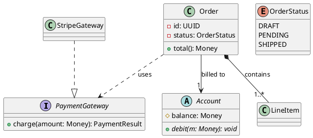

**Mermaid**

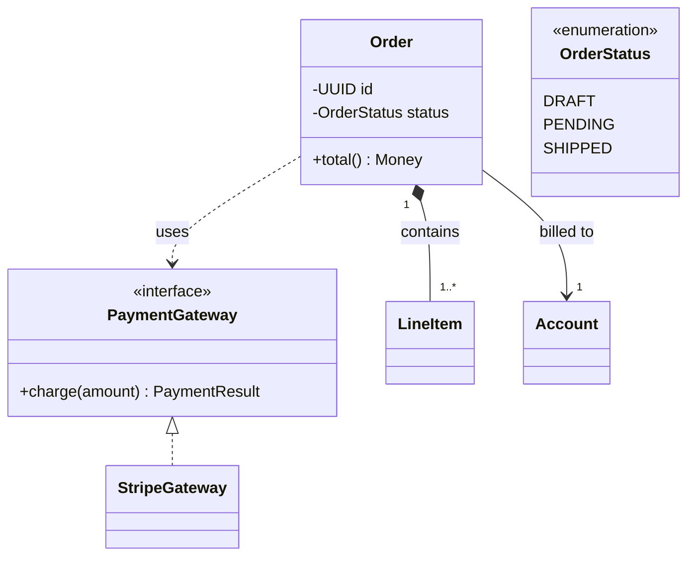

Notes:
- Mermaid puts the type *after* the member name in the shorthand form (`+total() Money`, `-UUID id`); PlantUML uses `name: Type`. Do not mix.
- Mermaid abstract members use a trailing `*` (`+debit()*`), static a trailing `$`.
- Multiplicity strings go in quotes on the ends of the relationship in both renderers.
- Mermaid `namespace Foo { class Bar }` is the closest thing to a package.

---

## 3. Sequence diagrams

Arrow semantics differ between renderers — this is the most frequently botched translation.

| Intent | PlantUML | Mermaid |
|---|---|---|
| Synchronous call | `A -> B: charge()` | `A->>B: charge()` |
| Return / response | `A --> B: result` (dashed) | `A-->>B: result` (dashed) |
| Asynchronous message | `A ->> B: OrderPlaced` (thin arrowhead) | `A-)B: OrderPlaced` |
| Lost / found message | `A ->o B` / `A o-> B` | not supported |
| Activation | `activate B` / `deactivate B` | `activate B` / `deactivate B`, or `A->>+B` / `B-->>-A` |
| Participant creation | `create B` | not supported |

**PlantUML**

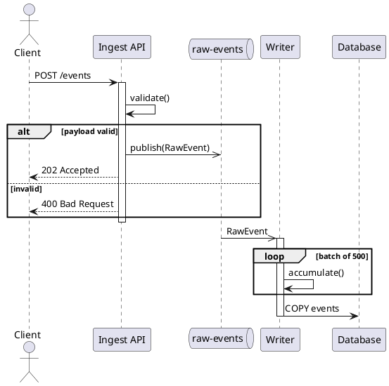

**Mermaid**

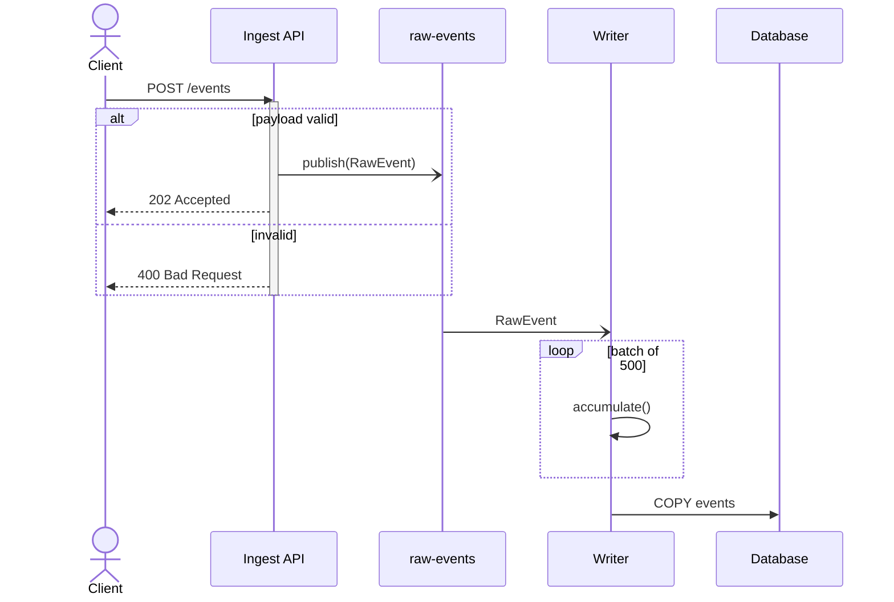

Control blocks, both renderers: `alt`/`else`, `opt`, `loop`, `par`/`and`, `break`, `critical`/`option`, closed by `end`. PlantUML additionally has `group`, `ref over`.

One sequence diagram covers **one** scenario. A diagram with five top-level `alt` blocks is really five diagrams, or one diagram at the wrong abstraction level.

---

## 4. State machines

Use for genuine lifecycle states — states that change what operations are legal. Do not use to depict a sequence of function calls; that is a sequence or activity diagram.

Transition form: `Source --> Target : trigger [guard] / action`

**PlantUML**

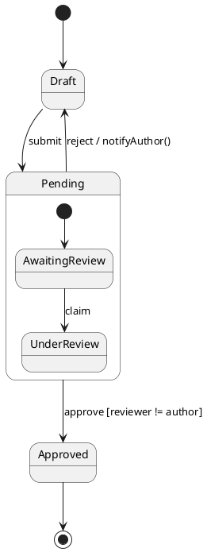

**Mermaid**

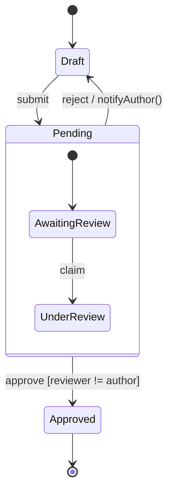

Pseudostates: `<<choice>>`, `<<fork>>`, `<<join>>` in Mermaid; `state x <<choice>>` in PlantUML. Concurrency uses `--` inside a composite state in both.

---

## 5. Activity / flow

PlantUML has real activity notation; Mermaid does not — use `flowchart` and say it is an approximation.

**PlantUML**

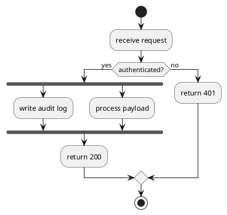

**Mermaid**

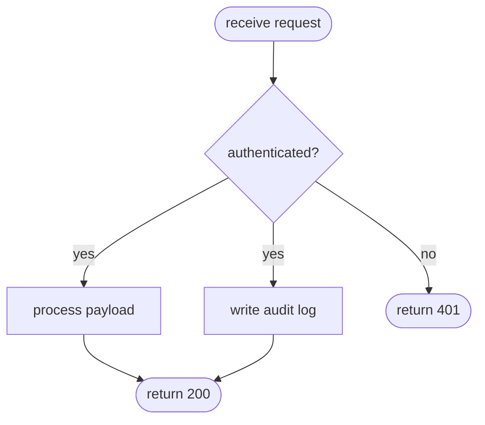

Mermaid flowcharts cannot express fork/join semantics precisely; parallel edges only imply it. State this when it matters.

---

## 6. Component and deployment

**PlantUML component**

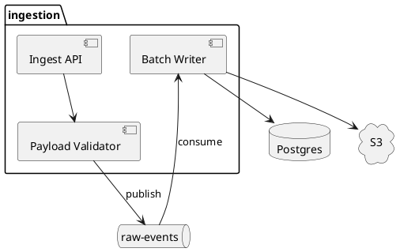

**PlantUML deployment**

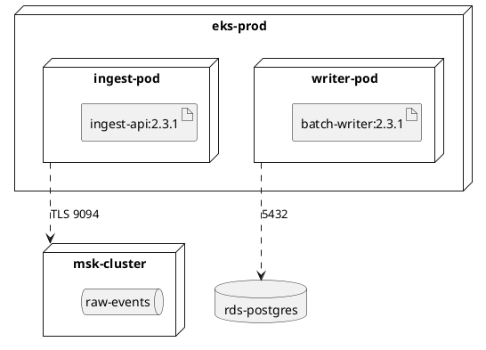

**Mermaid approximation** — no component or deployment diagram exists; use `flowchart` with `subgraph` for boundaries, and declare the approximation in the Purpose line.

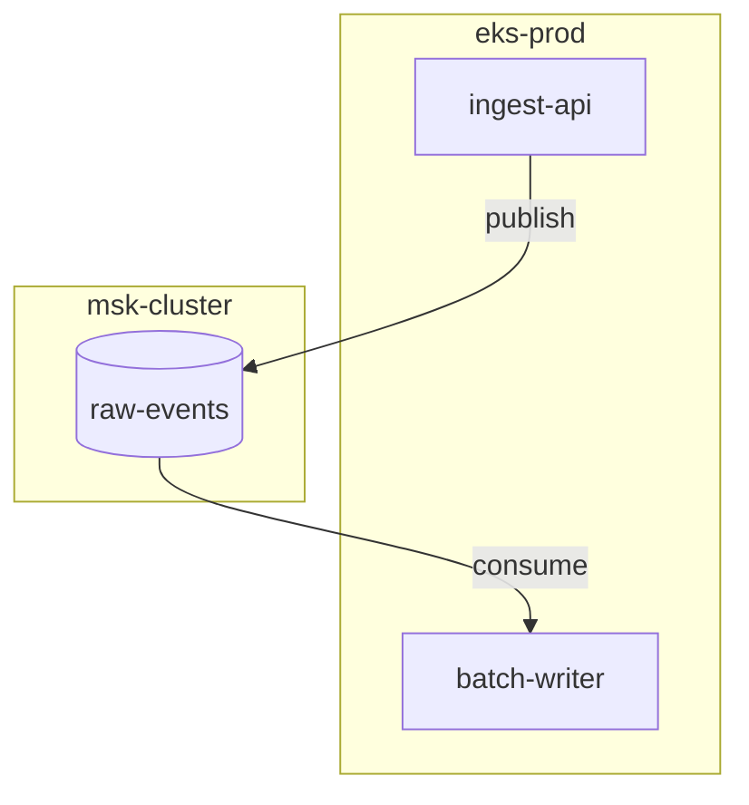

Shape conventions worth keeping consistent across diagrams: `[( )]` datastore, `[[ ]]` external system, `{ }` decision, `([ ])` terminal.

---

## 7. Object, package, use case, timing

PlantUML only.

```plantuml
' Object — one runtime instant
object "order:Order" as o {
    id = 3f9a
    status = PENDING
}
object "item1:LineItem" as i1
o --> i1

' Package
package "domain" {
    class Order
    class Customer
}
package "infrastructure" {
    class PostgresOrderRepo
}
infrastructure ..> domain

' Use case
left to right direction
actor Buyer
rectangle "Storefront" {
    Buyer -- (Place order)
    (Place order) ..> (Validate payment) : <<include>>
    (Place order) <.. (Apply promo) : <<extend>>
}

' Timing
robust "Connection" as C
concise "Request" as R
@0
C is Idle
@100
C is Connected
R is Processing
```

Use case diagrams describe externally visible capability only. Internal implementation belongs elsewhere.

---

## 8. ER diagrams

For relational schema — tables, columns, keys, cardinality. Do not conflate with a domain class diagram; an aggregate may span several tables, and a table may be pure infrastructure.

**Mermaid**

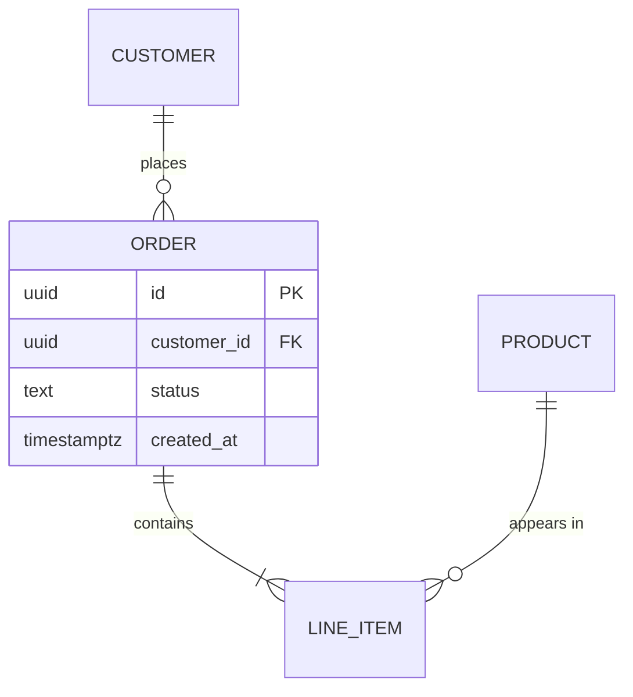

Cardinality tokens: `||` exactly one, `o|` zero-or-one, `}|` one-or-more, `}o` zero-or-more; identifying relationships use `--`, non-identifying `..`.

**PlantUML** uses `entity` with `*` for mandatory attributes, or the IE stdlib.

---

## 9. C4

**PlantUML** (stdlib):

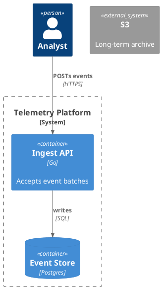

**Mermaid** has `C4Context` / `C4Container` / `C4Component` / `C4Dynamic` / `C4Deployment`, but they are experimental and their syntax has changed across releases. If the rendering version is not known, prefer PlantUML for C4.

C4 levels map onto the abstraction levels in SKILL.md: Context→L1, Container→L2, Component→L3, Code→L4.

---

## 10. Notes, constraints, layout

```plantuml
note right of Order
  Status transitions are enforced in
  OrderStateMachine, not in setters.
end note
```

```mermaid
note for Order "Status transitions enforced in OrderStateMachine"
```

Layout: prefer top-down for hierarchy and dependency, left-right for pipelines and flows (`flowchart LR`, `left to right direction`). Keep related elements adjacent. Minimize crossing edges, duplicate labels, decoration, and stereotype clutter. Split the diagram before fighting the layout engine.

Naming: for existing systems use the real identifiers, exactly. For new systems use consistent domain vocabulary. A proposed rename must never appear silently in a current-architecture diagram.

---

## 11. Renderer pitfalls

- **Mixed dialects.** `..|>` is PlantUML; Mermaid wants `<|..` with the operands swapped. Emitting one inside the other's fence produces a diagram that silently fails to render on the target surface.
- **Reversed inheritance arrows.** The triangle points at the parent. `A <|-- B` = B inherits A.
- **Mermaid label characters.** Parentheses, colons, and quotes inside node labels need quoting: `A["charge(amount)"]`.
- **Mermaid reserved words.** `end` as a node id breaks flowcharts; `graph` and `class` are keywords.
- **PlantUML alias collisions.** Names containing spaces need `as` aliases; repeated aliases silently merge distinct elements.
- **Version drift.** Mermaid features (`architecture-beta`, C4, `block`) vary by release. Stay in the stable core unless the target version is known.
- **Rendering ≠ correctness.** A diagram that renders can still assert a composition the code does not support. Syntax validation is the cheap half of validation.
